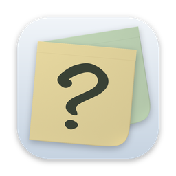
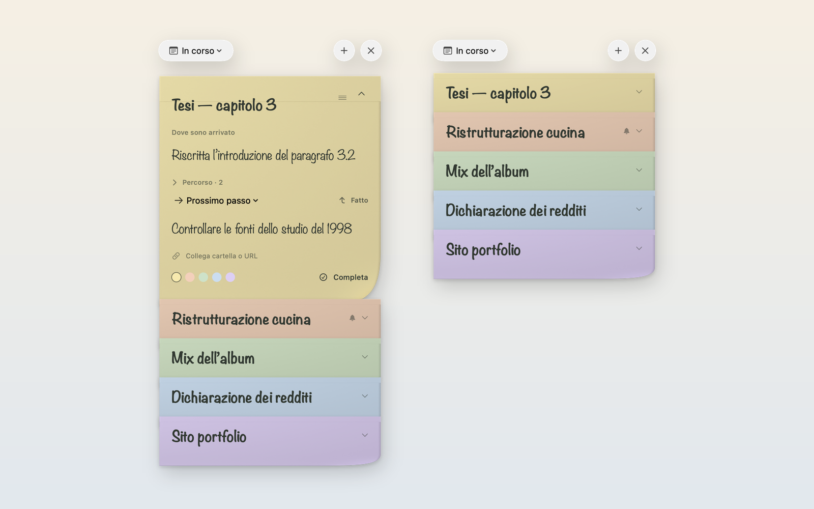

<div align="center">



# What’s Next?

**Post‑it di carta per la domanda che ti fai ogni volta che riprendi un lavoro: dove sono arrivato, e qual è il prossimo passo?**

Un’app nativa per macOS nella barra dei menu, con fogli scritti a mano, un pulsante **Fatto** che porta avanti il prossimo passo, promemoria per ciò che stai aspettando e un vero widget WidgetKit.

[**Scarica per macOS**](https://github.com/massimopozzi1989-gif/Whats-Next/releases/latest) · [Sito](https://massimopozzi1989-gif.github.io/Whats-Next/) · [English](README.md)



</div>

## Perché

Passare da un progetto all’altro costa soprattutto nei primi dieci minuti: rileggere, ricostruire, decidere. What’s Next? tiene su un foglio di carta solo due cose per ogni lavoro, **dove sei arrivato** e **il prossimo passo**, così per ripartire basta uno sguardo.

## Funzioni

- **Un foglio per lavoro, impilati come carta.** Di ogni foglio si vede solo la fascia del titolo: un clic in qualsiasi punto lo apre. Trascina un foglio chiuso per riordinare la pila.
- **Fatto ti porta avanti.** Premi **Fatto** (o **⌘↩**): il prossimo passo diventa “Dove sono arrivato”, pronto per quello successivo. Il punto precedente resta, con la data, nel **Percorso** del foglio.
- **Prossimo passo o In attesa.** Segna ciò che stai aspettando e imposta un promemoria: tra un’ora, domani alle 9, lunedì… All’ora giusta una notifica di macOS apre quel post-it.
- **I lavori fermi mostrano un orologio.** I fogli non toccati da 7 giorni (oppure 3, 14, 30 o mai, a tua scelta) indicano da quanto sono fermi.
- **Un widget che fa qualcosa.** Widget piccolo, medio e grande con la pila nell’ordine dell’app; tocca ↰ su un foglio per segnare fatto il passo senza aprire l’app.
- **Non ti disturba.** Vive nella barra dei menu, si apre con **⌃⌥Spazio** da qualsiasi app e non ruba il focus: l’app che stavi usando conserva la barra dei menu e torna in primo piano con Esc.
- **Collegamenti al lavoro.** Associa a ogni foglio una cartella o un URL e aprili da lì.
- **Annulla tutto.** ⌘Z / ⌘⇧Z valgono per la scrittura e per ogni azione: Fatto, colore, promemoria, completa e riapri.
- **Italiano e inglese**, da cambiare al volo nelle Impostazioni (anche il widget si adegua).
- **Privata per natura.** Nessun account, nessuna rete, nessuna statistica. Le note sono un semplice file JSON sul tuo Mac.

## Installazione

1. Scarica **WhatsNext‑x.y.z.dmg** dall’[ultima release](https://github.com/massimopozzi1989-gif/Whats-Next/releases/latest).
2. Aprilo e trascina **What’s Next** in **Applicazioni**.
3. Avviala: l’icona compare nella barra dei menu. **⌃⌥Spazio** mostra o nasconde il pannello.

L’app è firmata con Developer ID e notarizzata da Apple. Richiede macOS 14 Sonoma o successivo, su Apple silicon o Intel.

### Aggiungere il widget

Apri il Centro notifiche (clic sulla data nella barra dei menu), scegli **Modifica widget**, cerca **What’s Next?** e scegli il formato. Nelle impostazioni del widget puoi mostrare tutti i lavori in ordine, solo i completati o un singolo lavoro; con un solo lavoro compaiono anche “Dove sono arrivato” e il prossimo passo.

## Tastiera

| Scorciatoia | Azione |
| --- | --- |
| ⌃⌥Spazio | Mostra o nasconde il pannello da qualsiasi app |
| ⌘N | Nuovo post-it |
| ⌘↩ | Fatto: sposta il prossimo passo in “Dove sono arrivato” |
| ⌘Z / ⌘⇧Z | Annulla / ripeti |
| Esc | Nasconde il pannello |

## I tuoi dati

Le note sono in `~/Library/Application Support/DoveSonoArrivato/notes.json`, con salvataggio atomico. Una copia di sola lettura per il widget va nel contenitore App Group dell’app. Nulla lascia il Mac. Se il file non fosse leggibile, l’app conserva l’originale intatto e non lo sovrascrive.

## Compilare dal codice

Servono Xcode 16 o successivo e [XcodeGen](https://github.com/yonaskolb/XcodeGen) (`brew install xcodegen`).

```sh
swift test                 # test (senza widget né App Group)
zsh scripts/build-app.sh   # genera il progetto Xcode e crea dist/What's Next.app con il widget
zsh scripts/make-dmg.sh    # DMG firmato; notarizzato se esiste un profilo notarytool
```

La build firma con Developer ID per il team `8ZN67F8SW8`. Per usare il tuo team cambia team e identificatore App Group in `project.yml`, `App.entitlements`, `Widget.entitlements` e `Sources/DoveSonoArrivato/Shared/WidgetSnapshot.swift`.

Dettagli tecnici, struttura del progetto e roadmap sono nel [README in inglese](README.md#how-its-built).

## Licenza

[MIT](LICENSE) © 2026 Massimo Pozzi.

La scrittura a mano usa Noteworthy, un carattere incluso in macOS. Post‑it® è un marchio di 3M; questo progetto non è affiliato né approvato da 3M.
