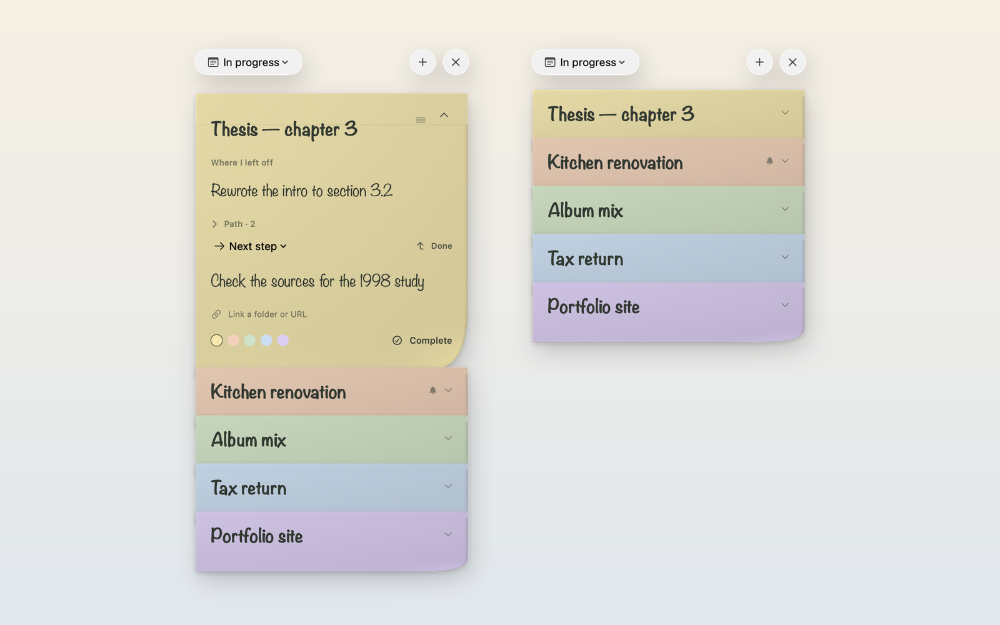

<div align="center">


# What’s Next?

**Paper notes for the question you ask every time you get back to work: where did I leave off, and what comes next?**

A native macOS menu‑bar app with hand‑written paper notes, a one‑click “Done” that moves your next step into place, reminders for things you’re waiting on, and a real WidgetKit widget.

[**Download for macOS**](https://github.com/massimopozzi1989-gif/Whats-Next/releases/latest) · [Website](https://massimopozzi1989-gif.github.io/Whats-Next/) · [Italiano](README.it.md)

   



</div>

## Why

Switching between projects costs the most in the first ten minutes back: rereading, reconstructing, deciding. What’s Next? keeps exactly two things per project on a sheet of paper — **where you left off** and **the next step** — so picking up again takes one glance.

## Features

- **One note per project, stacked like paper.** Each sheet shows only its title strip; click anywhere on it to open. Drag a closed sheet to reorder the stack.
- **Done moves you forward.** Click **Done** (or press **⌘↩**, or right‑click a closed note) and your next step becomes “Where I left off”, ready for the next one. The previous point is kept, dated, in the note’s **Path**.
- **Next step or waiting for.** Mark what you are waiting on and set a reminder — in an hour, tomorrow at 9, Monday, or any custom date and time. A macOS notification opens that note when it’s time, and a subtle dot on the menu‑bar icon reminds you of overdue waits.
- **A sticker for what matters.** Put a red priority sticker on any note — from the open note or with a right‑click — and it shows on the paper in the panel and in the widget, where priority notes come first.
- **A shelf for finished work.** Complete a note as an **App**, a **Website** or **Other**; the Completed list groups them by kind, newest first, with the date you finished.
- **Stale notes get a clock.** Notes you haven’t touched for 7 days (3, 14, 30 or never — your choice) show how long they’ve been sitting.
- **A widget that does something.** Small, medium and large widgets show your stack in order; tap ↰ on a note to mark its step done without opening the app.
- **Out of your way.** Lives in the menu bar, opens at login, toggles with **⌃⌥Space** (or your own custom global shortcut) from any app, and never steals focus: the app you were using keeps its menu bar and gets the keyboard back when you press Esc.
- **Links to your work.** Attach a folder or a URL to each note — or drop one right onto a sheet from Finder or your browser — and open it from the open note or via right‑click.
- **Copy as text.** Copy any note as clean plain text with **⌘⇧C**, the copy button, or right‑click.
- **Spotlight & Shortcuts.** Notes are indexed locally in Spotlight and exposed to macOS Shortcuts and Siri via App Intents.
- **Undo everything.** ⌘Z / ⌘⇧Z cover typing and every card action: Done, color, reminders, complete, reopen and delete (trash icon on the open note, or right‑click a closed one).
- **English and Italian**, switchable live in Settings (the widget follows).
- **Private by design.** No account, no network, no analytics. Notes are a plain JSON file on your Mac.

## Install

1. Download **WhatsNext‑x.y.z.dmg** from the [latest release](https://github.com/massimopozzi1989-gif/Whats-Next/releases/latest).
2. Open it and drag **What’s Next** into **Applications**.
3. Launch it: the note icon appears in the menu bar. Press **⌃⌥Space** to show or hide the panel.

The app is signed with a Developer ID and notarized by Apple. Requires macOS 14 Sonoma or later, Apple silicon or Intel.

### Add the widget

Open Notification Center (click the date in the menu bar), choose **Edit Widgets**, search for **What’s Next?** and pick a size. In the widget’s settings you can show all notes in order, only completed ones, or a single note — a single note also shows where you left off and the next step.

## Keyboard

| Shortcut | Action |
| --- | --- |
| ⌃⌥Space (customizable) | Show or hide the panel from any app |
| ⌘N | New note |
| ⌘F | Search notes |
| ↑ / ↓ / ↩ | Navigate notes and open or close the selected sheet |
| Tab / ⇧Tab | Move between fields in the open note |
| ⌘↩ | Done: move the next step to “Where I left off” |
| ⌘⇧C | Copy note as plain text |
| ⌘Z / ⌘⇧Z | Undo / redo |
| Esc | Close search or hide the panel |

## Your data

Notes live in `~/Library/Application Support/DoveSonoArrivato/notes.json`, written atomically. A read‑only copy for the widget is published to the app’s App Group container. Nothing leaves your Mac. If the file ever can’t be read, the app keeps the original untouched and refuses to overwrite it.

## Build from source

Requirements: Xcode 16 or later and [XcodeGen](https://github.com/yonaskolb/XcodeGen) (`brew install xcodegen`).

```sh
swift test                 # unit and UI-hosting tests (no widget, no App Group)
zsh scripts/build-app.sh   # generates the Xcode project, builds dist/What's Next.app with the widget
zsh scripts/make-dmg.sh    # signed DMG; notarized when a notarytool profile exists
```

The bundle build signs with a Developer ID for team `8ZN67F8SW8`. To build under your own team, change the team and the App Group identifier in `project.yml`, `App.entitlements`, `Widget.entitlements` and `Sources/DoveSonoArrivato/Shared/WidgetSnapshot.swift`.

## How it’s built

- **SwiftUI inside AppKit.** The panel is a borderless, non‑activating `NSPanel`; the stack is one native `NSScrollView` hosting SwiftUI, so trackpad momentum, drag‑to‑reorder and auto‑scroll are AppKit’s own.
- **Native text editors.** Writing happens in TextKit 1 `NSTextView`s sized by SwiftUI, which keeps first‑click editing and selection stable while the card re‑renders.
- **Cheap redraws.** Cards are `Equatable`, so typing re‑renders only the open sheet; paper textures are decoded once and only the paper casts a shadow.
- **Debounced, atomic saves.** Typing is staged in memory and written after a 180 ms pause; closing a card, hiding the panel or quitting flushes pending writes.
- **Widget → app without a server.** The sandboxed widget queues “Done” as small files in the App Group and wakes the app with a Darwin notification; the app applies each one only if that step is still current.
- **Paper modeled in Blender.** `Art/Blender/make_paper.py` renders the five paper textures used by both app and widget.

```
Sources/DoveSonoArrivato/   app: panel, board, editors, store, reminders, spotlight, shortcuts
Sources/DoveSonoArrivato/Shared/   shared with the widget: paper, snapshot, actions, localization
Widget/                     WidgetKit extension and App Intents
Tests/                      XCTest suite
Art/                        Blender model, render script and generated reference
scripts/                    build-app.sh, make-dmg.sh
docs/                       website (GitHub Pages)
```

## Roadmap

- iCloud sync and an iPhone app

Ideas and bug reports are welcome in [Issues](https://github.com/massimopozzi1989-gif/Whats-Next/issues).

## Contributing

Pull requests are welcome. Please run `swift test` before opening one and keep changes focused; user‑facing strings need both languages (`L("italiano", "English")`).

## License

[MIT](LICENSE) © 2026 Massimo Pozzi.

Handwriting uses Noteworthy, a font included with macOS. Post‑it® is a trademark of 3M; this project is not affiliated with or endorsed by 3M.
